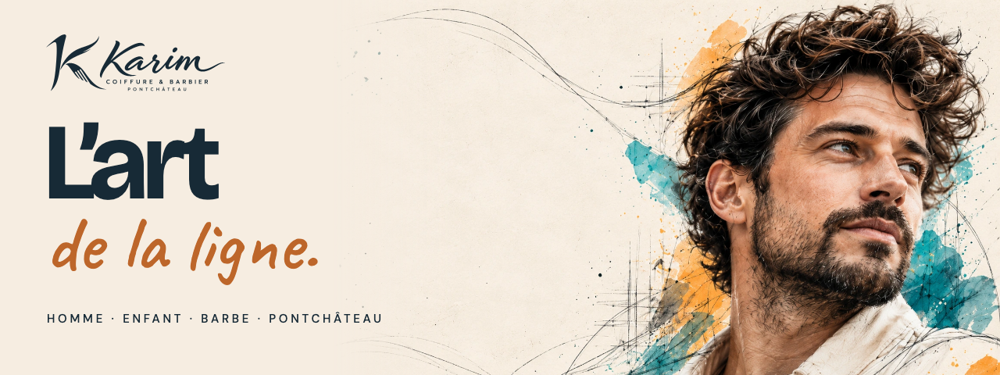
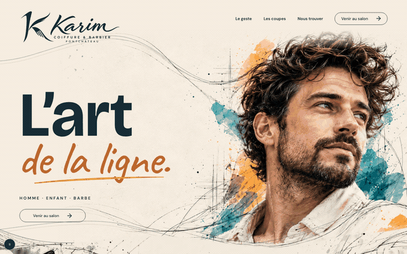
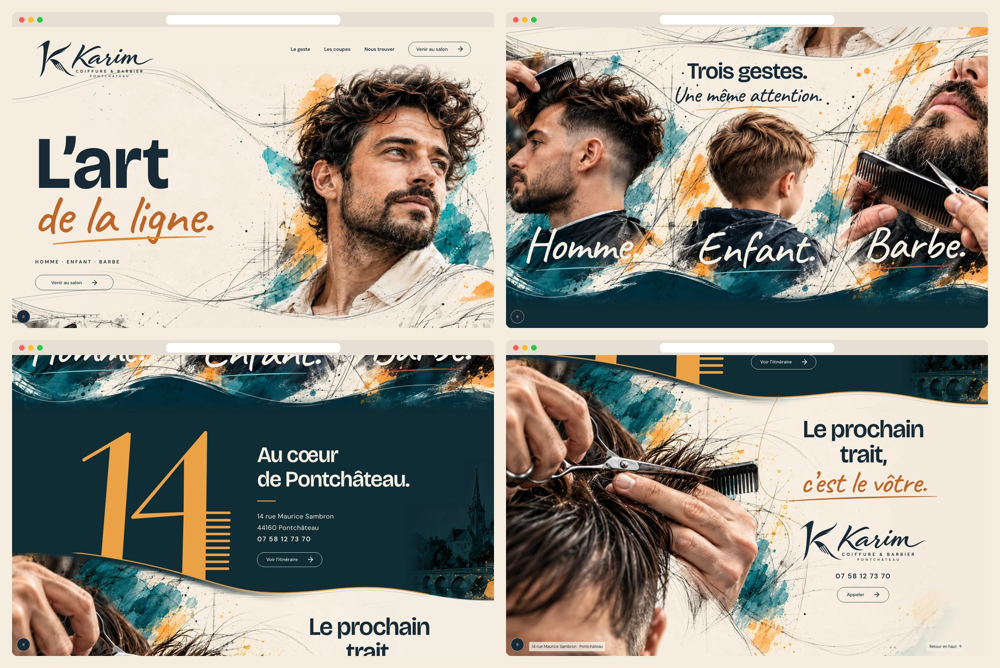
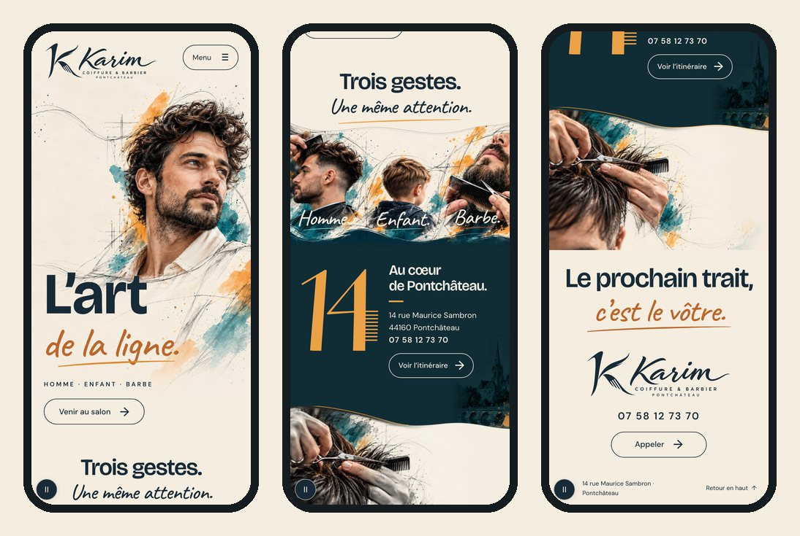
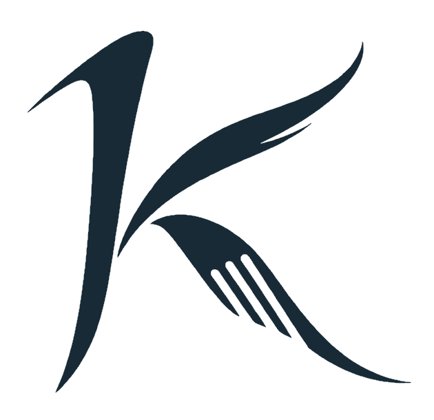

<div align="center">



<h3>A one-page website for a hairdresser and barber in Pontchâteau, France, where a pencil drawing turns into a photograph as you scroll.</h3>

<p>
  <a href="https://coiffure-karim-pontchateau.vercel.app"><strong>🌐 Live site</strong></a>
  &nbsp;·&nbsp;
  <a href="#hero-animation"><strong>🎬 How the animation works</strong></a>
  &nbsp;·&nbsp;
  <a href="#getting-started"><strong>🛠️ Run it locally</strong></a>
</p>

<p>
  <a href="https://coiffure-karim-pontchateau.vercel.app"></a>
  
  
  
  
</p>

</div>

<br />

## 🚀 Overview

**Coiffure Karim** cuts hair for men and children and trims beards at 14 rue Maurice Sambron in Pontchâteau. This site is built on one idea, *Les Lignes Vivantes* (the living lines): a graphite line runs from the top of the page to the last call to action, and everything it touches comes to life.

The brief had one hard rule on top of the approved design: **no "ultra zoom"**. Earlier sites filled the window with a narrow design board, so each screen showed a cropped fragment of a huge image. Here every image-led scene is sized from the window's **height** as well as its width, so the whole picture is always on screen.

- **Whole pictures**: the hero, the three-subject frieze and the closing macro each fit one screen, and nothing is cover-cropped
- **Scroll stays free**: no pinning, no scroll hijacking, no scroll-driven zoom; the page is exactly its four scenes
- **Clear path to contact**: Venir au salon, Voir l’itinéraire and Appeler are real links at every stage
- **Built for every visitor**: readable with JavaScript off, full keyboard support, and three ways to switch motion off

<br />

<a name="hero-animation"></a>

## 🎬 The animation

<div align="center">
  <a href="https://coiffure-karim-pontchateau.vercel.app"></a>
  <sub>A steady scroll through the whole page · captured at 1440 × 900</sub>
</div>

<br />

Each scene uses its own technique, and the same pencil line carries you from one to the next:

| Scene | Technique | What happens |
| :---- | :-------- | :----------- |
| **Opening** | Timed, 2 s | The portrait opens through a diagonal mask from grey to colour while the pencil lines draw themselves. It never blocks the page and cancels on the first scroll. |
| **Les coupes** | Scroll-scrubbed brush | A bristled brush crosses the frieze and paints it from **graphite to photograph**, then *Homme. Enfant. Barbe.* are handwritten one after the other. |
| **Nous trouver** | Scroll-scrubbed writing | The **14** is written stroke by stroke, then the nine comb teeth come out one at a time. |
| **Contact** | Scroll-scrubbed radial | The macro develops outwards **from the scissors**, while the saffron line runs along the join and lands as the underline of *c’est le vôtre.* |

**Under the hood**

- 📐 **Sized from the window, not the board.** The approved board is only 568 px wide. Stretched to a 1440 px window it would scale every image 2.5 times. Instead, each plate is placed from `min(window height, width)` and shown whole, with paper filling any spare width.
- 🖼️ **No hard seams.** The frieze and the macro carry a wave in their alpha channel and rise over the previous scene, so the shirt shows through one join and the 14 is cut by the other, as on the board.
- ✏️ **Graphite derived from the master.** The pencil plate is a colour-dodge of the same image, so the brush reveals pixels that register exactly.
- 🖌️ **Works from `file://`.** The bristle mask is inlined as a data URI because external CSS masks are blocked on local files.
- 🐢 **Graceful by default.** With reduced motion, Save-Data or the pause button, everything shows in its final state and the graphite plate is never downloaded.

### Whole picture, measured

Real browser window sizes, checked on every QA run. "Head" is the height of the main portrait against the window.

| Window | Hero | Head (hero) | Frieze, three subjects | Location | Closing |
| :----- | :--: | :---------: | :--------------------: | :------: | :-----: |
| 1280 × 650 | 1.00 | 62 % | 0.90 | 0.76 | 1.00 |
| 1440 × 790 | 1.00 | 62 % | 0.83 | 0.75 | 1.00 |
| 1536 × 730 | 1.00 | 62 % | 0.96 | 0.76 | 1.00 |
| 1792 × 1000 | 1.00 | 62 % | 0.82 | 0.73 | 1.00 |
| 1920 × 950 | 1.00 | 62 % | 0.92 | 0.76 | 1.00 |
| 2560 × 1300 | 0.91 | 56 % | 0.90 | 0.69 | 0.91 |

Values are in screens. Scale during scroll peaks at 1.018, the limit set in the motion script.

<br />

## 🖥️ Sections

<div align="center">
  
</div>

<br />

| #   | Scene                                  | Anchor         | Role                                                                    |
| :-- | :------------------------------------- | :------------- | :---------------------------------------------------------------------- |
| 01  | **L’art de la ligne.**                 | `#accueil`     | Portrait, logo, navigation and first call to action                     |
| 02  | **Trois gestes. Une même attention.**  | `#les-coupes`  | One continuous frieze; each word opens the service details              |
| 03  | **Au cœur de Pontchâteau.**            | `#nous-trouver`| The only flat colour on the page: the 14-comb, address, phone and route |
| 04  | **Le prochain trait, c’est le vôtre.** | `#contact`     | Haircut macro, brand, phone, Appeler and the footer                     |

<br />

## 📱 Mobile first, motion optional

<div align="center">
  
</div>

<br />

- The portrait stands above the title, with a dedicated vertical image
- The frieze stays whole and the macro sits above the contact block
- Every touch target is at least 44 px, with no horizontal scroll from 320 px up
- Nothing depends on hover

<br />

## ✨ Highlights

- **🎯 Hover that means something**: hovering *Homme.* keeps that field in colour and sends the other two back to pencil
- **💬 Accessible service details**: native `<dialog>` with tabs, arrow keys, Home/End, Escape and focus return; without JavaScript each word simply calls the salon
- **⏸️ Motion is a choice**: pause button with a saved preference, `prefers-reduced-motion` and Save-Data
- **🏙️ Restored from the board**: the painted town and the nine-tooth 14 were rebuilt from the approved design
- **🖼️ Image pipeline**: untouched PNG masters, 2x plates from a 60/40 blend of Real-ESRGAN and Lanczos so skin keeps its grain
- **🧪 Real browser QA**: density, clicks with a real pointer, keyboard, no-JS, reduced motion, Save-Data, hash entry and restored scroll

<br />

## 💻 Tech stack

| <br />HTML5 | <br />CSS3 | <br />JavaScript | <br />Python (images) | <br />Vercel |
| :---: | :---: | :---: | :---: | :---: |

### Why this stack?

- **Plain HTML, CSS and JavaScript**: the approved kit calls for a static site with no build, no CDN and no runtime dependency, so `site/index.html` opens straight from disk
- **Small custom scroll loop**: `requestAnimationFrame` runs only on scroll events, with no permanent loop and no animation library
- **Self-hosted fonts**: Bricolage Grotesque, DM Sans and Caveat with no third-party requests
- **Vercel**: `vercel.json` publishes the `site/` folder as it is

<br />

## 🎨 Design system

| Token          | Value                                                                        | Use                               |
| :------------- | :--------------------------------------------------------------------------- | :-------------------------------- |
| Pétrole        |   | Text, logo, buttons               |
| Scene pétrole  |   | Scene 3, sampled from the board   |
| Papier         |   | Text on dark, dialog              |
| Safran         |   | The 14, the seam line             |
| Bleu-pétrole   |   | Accents, link hover               |
| Corail         |   | Barbe underline, focus ring       |
| Encre manuscrite |  | Handwritten words on paper        |

- **Type**: Bricolage Grotesque for titles, DM Sans for text and interface, Caveat for handwritten accents
- **Density**: one height-aware unit per scene; small text never goes under 11 px
- **Motion**: limits come from `motion/timeline.json`; stage scale never exceeds 1.018

<br />

<a name="getting-started"></a>

## 🛠️ Getting started

```bash
# Clone the repository
git clone https://github.com/Jeanfr1/Coiffure-Karim-website.git
cd Coiffure-Karim-website

# No install needed to view it: open site/index.html, or serve it
npm run dev            # → http://localhost:4416

# Browser QA (needs the server above)
npm install
npm run qa

# Static checks from the design kit
python3 tools/conferir-kit.py

# Rebuild the plates from the masters (2x upscale first, see scripts/upscale.py)
npm run images
```

<br />

## 📁 Project structure

```text
site/                 The website: published as is
  index.html            Four scenes, inline SVG for the 14 and the seams
  styles.css            Layout, density units, motion states
  brush.css             Bristle mask (generated)
  app.js                Scroll loop, opening, menu, dialog, pause
  content.js            Contact data and service texts
  assets/ fonts/        Plates, logo, local fonts
scripts/              Image plates, QA, README captures
images/master/        Original PNG masters (untouched)
brand/ fonts/         Logo, K, tokens, type with OFL licences
motion/ roteiros/     Motion timeline and the kit's written scripts
docs/ references/     Copy, approved board, kit inventory
tools/                The kit's checker and exporter
LEIA-ME-KIT.md        The design kit's original README
```

<br />

## 🚀 Deployment

Hosted on **Vercel** and connected to this repository: every push to `main` ships to production.

**Live site:** [coiffure-karim-pontchateau.vercel.app](https://coiffure-karim-pontchateau.vercel.app)

| Setting          | Value                |
| :--------------- | :------------------- |
| Framework        | None (static)        |
| Build command    | None                 |
| Output directory | `site`               |
| Indexing         | `noindex` for now    |

<br />

## 📌 Content checklist

Items waiting on the owner. Each one is marked `TODO(karim)` in `site/content.js`.

- [ ] Final domain, then remove `noindex` and add `canonical` and `og:url`
- [ ] Link to the salon's own Google Maps place (an address search is used for now, as the kit specifies)
- [ ] Confirm the three service texts
- [ ] Opening hours and prices: a directory lists them, but they stay off the site until confirmed
- [ ] Mentions légales with the real company details

Design notes kept from the brief:

- The portraits are campaign illustrations, not the owner, staff or real clients
- The painted town is a free decorative motif, not a documentary view of Pontchâteau
- The kit's Caveat font is used for the handwriting; the board's lettering was an illustration, so it is close rather than identical
- Each scene follows the board's composition but is drawn smaller than the board, on purpose, so the image fits the screen

<br />

## 🙏 Acknowledgments

- **Coiffure Karim** for the salon details and the approved *Les Lignes Vivantes* direction
- **[Bricolage Grotesque](https://fonts.google.com/specimen/Bricolage+Grotesque)**, **[DM Sans](https://fonts.google.com/specimen/DM+Sans)** and **[Caveat](https://fonts.google.com/specimen/Caveat)** (OFL)
- **[Real-ESRGAN](https://github.com/xinntao/Real-ESRGAN)** for the 2x plates
- **[Playwright](https://playwright.dev)** for the browser QA

<br />

---

<div align="center">
  
  <p><strong>Le prochain trait, c’est le vôtre.</strong></p>
  <p>Built with ❤️ by <a href="https://github.com/Jeanfr1">Jean</a> for Coiffure Karim</p>
  <sub>© 2026 Coiffure Karim. All rights reserved.</sub>
</div>
